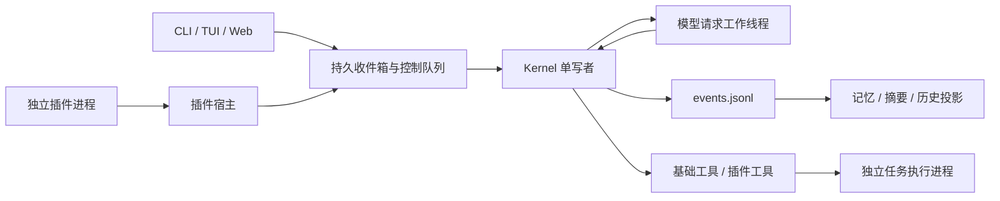

# 架构

## 运行协调

`Kernel` 持有存档实例锁和事件单写者。模型客户端在受控工作线程中完成一个同步请求，
主线程同时轮询插件、持久收件箱和后台任务。模型线程不写事件；一次请求使用固定配置、
工具 schema 和插件世代，配置/管理命令在请求之间应用。

## 模块职责

| 模块 | 职责 |
|---|---|
| loop / coordinator / control | 生命周期、单写者、模型请求协调、持久输入与中断 |
| events / atomic / lock | 完整行读取、事件序号、原子替换、独占锁 |
| memory / migration / compress / trim | 记忆 checkpoint、旧档迁移、摘要事务、活动日志归档 |
| config / llm / messages / tokens / usage | 通用 API、思考映射、完整工具对话、预算和累计用量 |
| plugins / plugin_sdk | manifest、stdio 协议、监督、动态工具、输入和事件订阅 |
| tools / jobs / job_runner | 文件与记忆工具、后台执行、独立输出限制、恢复和终止 |
| platform / tui/terminal | Linux 文件锁、进程身份、进程组、终端能力 |
| cli / tui / web | 控制面；不直接写事件或记忆投影 |

## 数据与事务

`Runtime/events.jsonl` 记录 Agent 的事实；`memory-checkpoint.json` 保存记忆内容、哈希和
已应用 seq，`LongTermMemory.txt` 是可恢复投影。输入先持久化后 ACK，再提交 user/message，
最后推进消费位置和去重记录。摘要先提交事件，再替换 Digest；中断后根据提交状态恢复。

`usage.jsonl` 是独立累计账本；启动和 trim 前从事件补齐，避免裁剪后费用回退。
价格必须显式配置；历史缺失价格/缓存数据时不臆造。`History.txt` 是可重建的阅读投影。

首次迁移保存旧人格、记忆、摘要、History 和事件的原始字节基线；迁移副本保留其他文件。
核心不重放旧工具副作用，历史无进程身份的 running 任务仅显示为 historical。

## 故障边界

插件使用独立进程、有限队列、超时、心跳和有限重启。故障转成工具结果或限频系统通知，
其他插件和内核继续工作；进程隔离不是权限沙箱。存储不可恢复错误会停止写入，避免扩大损坏。
临时 API 错误有限重试；参数或认证错误阻塞下一次请求，等待配置修复。

后台任务由独立执行进程捕获输出，内核退出后仍可继续写文件；新内核根据 boot ID、PID、
启动 tick 验证身份后接管。stdout/stderr 各最多 16 MiB，超过后终止任务。
清理只回收已终止且活动事件不再引用的旧任务。
